<div align="center">

# 🪐 WeinSolar — Curso de Spec-Driven Development (SDD)

**De picar código a orquestar soluciones** · *From writing code to orchestrating solutions*

[](https://youtube.com/@weincode)
[](#)
[](#)
[](#)

**[🇪🇸 Español](#-español)** | **[🇺🇸 English](#-english)**

</div>

---

## 🇪🇸 Español

Bienvenido al repositorio oficial del **Curso de Spec-Driven Development (SDD)** de **Weincode**.

En la era de la Inteligencia Artificial generativa, el valor del desarrollador ya no radica en ser un traductor de sintaxis, sino en su capacidad de abstracción, gobierno y arquitectura. Este repositorio demuestra cómo diseñar y evolucionar un producto desde sus leyes inmutables (**Constitución**) y especificaciones funcionales (**100% agnósticas a la tecnología**), pasando por planes técnicos auditables y desgloses de tareas trazables, para que los agentes de código construyan la solución exacta en múltiples plataformas sin alucinaciones.

### 🚀 El Proyecto Demostrativo: WeinSolar

**WeinSolar** es un simulador interactivo 3D de descenso planetario y observación crepuscular y nocturna. Los usuarios experimentan fuerzas gravitatorias reales, resistencias atmosféricas, terrenos 3D procedurales, sombras dinámicas y fenómenos ópticos de atardecer y bóveda celeste nocturna fieles a cada cuerpo del sistema solar (**Tierra, Marte, Luna y Titán**), manteniendo la identidad cromática de Weincode (`#18084D`, `#5236FF`, `#A599FF`) en su telemetría y cabina.

Lo más potente de este repositorio es que **cada ciclo de especificación (`specs/<feature>/`) gobierna dos implementaciones completamente distintas con paridad funcional y numérica garantizada**:

| Plataforma | Stack Tecnológico | Ubicación |
| :--- | :--- | :--- |
| 🅰️ **Aplicación Web** | **Angular 21** (Signals, Standalone, Clean Architecture, `angular-three` + `Three.js` WebGL2) | `/apps/weinsolar-angular` |
| 💙 **Aplicación Móvil / Multiplataforma** | **Flutter 3.41** (Material 3, Clean Architecture, `flutter_scene` + Impeller GPU 3D) | `/apps/weinsolar-flutter` |

### 📂 Estructura Real del Repositorio

```text
weincode-sdd-course/
├── .specify/                                # Motor y Gobierno SDD (SpecKit)
│   ├── memory/
│   │   └── constitution.md                  # ⚖️ Constitución: principios inmutables y Quality Gates
│   ├── templates/                           # Plantillas normativas (spec, plan, tasks, checklist)
│   └── workflows/                           # Definición declarativa del ciclo SDD completo
├── specs/                                   # Artefactos SDD versionados por funcionalidad (Feature Branches)
│   ├── 001-planetary-lander-sunset/         # Iteración 1: Simulación física, telemetría y crepúsculo
│   └── 002-realistic-3d-scene/              # Iteración 2: Entorno 3D realista, terreno, sombras y cielo nocturno
│       ├── spec.md                          # 1. Qué y Por qué (100% agnóstico a la tecnología)
│       ├── checklists/                      #    Validación de calidad de requisitos (requirements.md)
│       ├── plan.md                          # 2. Cómo técnico + Constitution Check dual-stack
│       ├── research.md                      #    Decisiones arquitectónicas y evaluación de alternativas
│       ├── data-model.md                    #    Entidades de dominio, Value Objects e invariantes
│       ├── contracts/                       #    Contratos de escena, interfaces y fixtures numéricos
│       ├── quickstart.md                    #    Guía de verificación y humo en ambos stacks
│       └── tasks.md                         # 3. Tareas atómicas ordenadas por fases e historias (US1..USn)
├── .github/
│   ├── instructions/                        # Reglas arquitectónicas y de código específicas por stack
│   │   ├── angular-instructions.md          # Clean Architecture, Signals y estándares en Angular
│   │   └── flutter-instructions.md          # Clean Architecture, Widget testing y estándares en Flutter
│   ├── agents/                              # Agentes especializados por fase del ciclo SDD
│   └── prompts/                             # Prompts ejecutables (/speckit-*)
├── AGENTS.md                                # Punto de entrada de contexto y reglas activas para agentes IA
└── apps/
    ├── weinsolar-angular/                   # Implementación Web en Angular 21 + Three.js
    └── weinsolar-flutter/                   # Implementación Multiplataforma en Flutter + Impeller 3D
```

### 🔄 El Verdadero Ciclo de Vida SDD (Full SDD Cycle)

El desarrollo guiado por especificaciones no consiste en pedir código directamente a un LLM, sino en avanzar a través de **artefactos deterministas con compuertas de revisión (*Review & Quality Gates*)**:

```mermaid
flowchart LR
    C["⚖️ 0. Constitución<br/>/speckit-constitution<br/>(constitution.md)"] --> S["📋 1. Especificar<br/>/speckit-specify<br/>(spec.md)"]
    S --> CL["🔍 1b. Clarificar<br/>/speckit-clarify &<br/>/speckit-checklist"]
    CL -->|Gate: Spec aprobada| P["🏗️ 2. Planificar<br/>/speckit-plan<br/>(plan, research, contracts)"]
    P -->|Gate: Constitution Check| T["🗂️ 3. Desglosar Tareas<br/>/speckit-tasks<br/>(tasks.md)"]
    T --> A["🧪 3b. Analizar<br/>/speckit-analyze<br/>(Auditoría cruzada)"]
    A -->|Gate: Cobertura 100%| I["⚙️ 4. Implementar<br/>/speckit-implement<br/>(Angular + Flutter)"]
```



#### Fase 0 — Gobierno y Constitución (`/speckit-constitution`)
* **Artefacto:** `.specify/memory/constitution.md`
* **Propósito:** Establece la ley suprema del repositorio antes de diseñar cualquier funcionalidad: paridad funcional y numérica dual-stack, aislamiento estricto de dominio físico puro (sin dependencias de UI o motores 3D), fidelidad cromática Weincode, pruebas obligatorias y compuertas de calidad (*Quality Gates*).

#### Fase 1 — Especificación Funcional y Clarificación (`/speckit-specify` · `/speckit-clarify` · `/speckit-checklist`)
* **Artefactos:** `specs/<NNN-feature>/spec.md` y `specs/<NNN-feature>/checklists/`
* **Propósito:** Define **QUÉ** se construye y **POR QUÉ**, manteniendo el documento **100% libre de detalles de implementación o stacks tecnológicos**.
  * **Historias de Usuario Priorizadas (`P1`, `P2`, `P3`):** Cada historia debe ser independientemente desplegable y verificable.
  * **Requisitos Funcionales (`FR-XXX`), Casos Límite (*Edge Cases*) y Criterios de Éxito medibles (`SC-XXX`).**
  * **Clarificación Socrática (`/speckit-clarify`):** Detecta zonas ambiguas o subespecificadas mediante preguntas estructuradas de opción múltiple con análisis de *trade-offs*, codificando las decisiones de vuelta en `spec.md`.
  * **Compuerta de Revisión (*Spec Gate*):** Validación mediante `/speckit-checklist` para confirmar que no quedan marcadores `[NEEDS CLARIFICATION]` ni filtraciones tecnológicas antes de pasar al diseño técnico.

#### Fase 2 — Planificación Arquitectónica (`/speckit-plan`)
* **Artefactos:** `specs/<NNN-feature>/plan.md`, `research.md`, `data-model.md`, `contracts/` y `quickstart.md`
* **Propósito:** Traduce el contrato funcional agnóstico al **CÓMO** técnico para cada plataforma, respetando las reglas de `AGENTS.md` y `.github/instructions/`:
  * **Constitution Check:** Verifica explícitamente que la arquitectura propuesta cumpla cada principio de `constitution.md`.
  * **Investigación (`research.md`):** Resuelve incógnitas técnicas documentando **Decisión**, **Justificación (*Rationale*)** y **Alternativas descartadas**.
  * **Modelo de Datos y Contratos (`data-model.md` y `contracts/`):** Define entidades de dominio puro, *Value Objects*, invariantes matemáticos, contratos de adaptadores 3D y *fixtures* compartidos de paridad numérica.

#### Fase 3 — Desglose de Tareas y Auditoría de Consistencia (`/speckit-tasks` · `/speckit-analyze` · `/speckit-taskstoissues`)
* **Artefacto:** `specs/<NNN-feature>/tasks.md`
* **Propósito:** Transforma el plan técnico en una hoja de ruta ejecutable ordenada por dependencias y fases:
  * **Estructura por Fases:** *Phase 1 (Setup)* → *Phase 2 (Foundational / Dominio compartido)* → *Phases 3..N (Una fase por cada Historia de Usuario `US1..USn` en orden de prioridad)* → *Final Phase (Polish & Cross-Cutting Concerns)*.
  * **Trazabilidad y Paralelismo:** Cada tarea (`T001`, `T002`...) indica su historia (`[US1]`), si es paralelizable (`[P]`) y la ruta exacta del archivo en Angular o Flutter.
  * **Auditoría Cruzada (`/speckit-analyze`):** Ejecuta un análisis no destructivo de consistencia entre `spec.md` ↔ `plan.md` ↔ `tasks.md` ↔ `constitution.md` para detectar requisitos huérfanos, desviaciones o huecos de cobertura antes de escribir código.

#### Fase 4 — Implementación Gobernada y Verificación (`/speckit-implement`)
* **Artefactos:** Código fuente y suites de pruebas en `/apps/weinsolar-angular` y `/apps/weinsolar-flutter`
* **Propósito:** Ejecuta secuencialmente las tareas de `tasks.md` aplicando **Clean Architecture** y desarrollo guiado por pruebas:
  * **TDD y Paridad Numérica:** Primero se implementan y prueban las fórmulas físicas y *mappers* contra los *fixtures* numéricos compartidos (tolerancia `≤ 1e-4`), luego la capa de aplicación/estado y finalmente los componentes visuales y la escena 3D.
  * **Compuertas de Calidad (*Quality Gates*):** Ninguna funcionalidad se marca como completada sin pasar el análisis estático (`flutter analyze` / `ng build`) y el 100% de los tests unitarios y de widgets/componentes en ambos stacks.

---

## 🇺🇸 English

Welcome to the official repository for **Weincode's Spec-Driven Development (SDD) Course**.

In the era of Generative AI, a developer's true value no longer lies in manually translating syntax, but in system abstraction, governance, and software architecture. This repository demonstrates how to design and evolve a software product starting from its immutable laws (**Constitution**) and functional specifications (**100% technology-agnostic**), moving through auditable technical plans and traceable task breakdowns so AI coding agents can build the exact solution across multiple platforms without hallucinations.

### 🚀 The Showcase Project: WeinSolar

**WeinSolar** is an interactive 3D planetary landing, twilight, and night-sky observation simulator. Users experience real gravitational forces, atmospheric drag, procedural 3D terrain, dynamic shadows, and optical sunset and nocturnal celestial phenomena across Solar System bodies (**Earth, Mars, Moon, and Titan**), wrapped in Weincode's signature cockpit telemetry UI (`#18084D`, `#5236FF`, `#A599FF`).

The core highlight of this repository is that **each specification cycle (`specs/<feature>/`) governs two completely different tech stacks with guaranteed functional and numerical parity**:

| Platform | Tech Stack | Path |
| :--- | :--- | :--- |
| 🅰️ **Web Application** | **Angular 21** (Signals, Standalone, Clean Architecture, `angular-three` + `Three.js` WebGL2) | `/apps/weinsolar-angular` |
| 💙 **Mobile / Cross-Platform** | **Flutter 3.41** (Material 3, Clean Architecture, `flutter_scene` + Impeller GPU 3D) | `/apps/weinsolar-flutter` |

### 📂 Actual Repository Structure

```text
weincode-sdd-course/
├── .specify/                                # SDD Engine & Governance (SpecKit)
│   ├── memory/
│   │   └── constitution.md                  # ⚖️ Constitution: immutable principles & Quality Gates
│   ├── templates/                           # Normative templates (spec, plan, tasks, checklist)
│   └── workflows/                           # Declarative Full SDD Cycle workflow definition
├── specs/                                   # Versioned SDD artifacts per feature branch
│   ├── 001-planetary-lander-sunset/         # Iteration 1: Physics simulation, telemetry & twilight
│   └── 002-realistic-3d-scene/              # Iteration 2: Realistic 3D scene, terrain, shadows & night sky
│       ├── spec.md                          # 1. What & Why (100% technology-agnostic)
│       ├── checklists/                      #    Requirements quality validation (requirements.md)
│       ├── plan.md                          # 2. Technical How + Dual-Stack Constitution Check
│       ├── research.md                      #    Architectural decisions & evaluated alternatives
│       ├── data-model.md                    #    Domain entities, Value Objects & invariants
│       ├── contracts/                       #    Scene contracts, interfaces & numerical fixtures
│       ├── quickstart.md                    #    Verification & smoke-test guide for both stacks
│       └── tasks.md                         # 3. Atomic tasks ordered by phases & stories (US1..USn)
├── .github/
│   ├── instructions/                        # Stack-specific architectural & coding instructions
│   │   ├── angular-instructions.md          # Clean Architecture, Signals & Angular standards
│   │   └── flutter-instructions.md          # Clean Architecture, Widget testing & Flutter standards
│   ├── agents/                              # Specialized agents for each SDD lifecycle stage
│   └── prompts/                             # Executable slash-command prompts (/speckit-*)
├── AGENTS.md                                # Context entrypoint & active rules for AI coding agents
└── apps/
    ├── weinsolar-angular/                   # Web implementation in Angular 21 + Three.js
    └── weinsolar-flutter/                   # Cross-platform implementation in Flutter + Impeller 3D
```

### 🔄 The True SDD Lifecycle (Full SDD Cycle)

Spec-Driven Development is not about prompting an LLM directly for code—it is an engineering discipline that progresses through **deterministic artifacts guarded by Review & Quality Gates**:

```mermaid
flowchart LR
    C["⚖️ 0. Constitution<br/>/speckit-constitution<br/>(constitution.md)"] --> S["📋 1. Specify<br/>/speckit-specify<br/>(spec.md)"]
    S --> CL["🔍 1b. Clarify<br/>/speckit-clarify &<br/>/speckit-checklist"]
    CL -->|Gate: Spec Approved| P["🏗️ 2. Plan<br/>/speckit-plan<br/>(plan, research, contracts)"]
    P -->|Gate: Constitution Check| T["🗂️ 3. Tasks<br/>/speckit-tasks<br/>(tasks.md)"]
    T --> A["🧪 3b. Analyze<br/>/speckit-analyze<br/>(Cross-Artifact Audit)"]
    A -->|Gate: 100% Coverage| I["⚙️ 4. Implement<br/>/speckit-implement<br/>(Angular + Flutter)"]
```



#### Stage 0 — Governance & Constitution (`/speckit-constitution`)
* **Artifact:** `.specify/memory/constitution.md`
* **Purpose:** Establishes the repository's supreme law before designing any feature: dual-stack functional and numerical parity, strict pure-domain physics isolation (zero UI or 3D engine dependencies), Weincode color fidelity, mandatory automated tests, and strict Quality Gates.

#### Stage 1 — Functional Specification & Clarification (`/speckit-specify` · `/speckit-clarify` · `/speckit-checklist`)
* **Artifacts:** `specs/<NNN-feature>/spec.md` & `specs/<NNN-feature>/checklists/`
* **Purpose:** Defines **WHAT** is being built and **WHY**, keeping the document **100% free of implementation details or tech stacks**.
  * **Prioritized User Stories (`P1`, `P2`, `P3`):** Every story is an independently testable and deployable slice of value.
  * **Functional Requirements (`FR-XXX`), Edge Cases, and measurable Success Criteria (`SC-XXX`).**
  * **Socratic Clarification (`/speckit-clarify`):** Identifies underspecified areas via targeted multiple-choice questions and trade-off analysis, encoding answers directly back into `spec.md`.
  * **Review Gate (*Spec Gate*):** Validated via `/speckit-checklist` to ensure zero `[NEEDS CLARIFICATION]` markers and zero tech-stack leakage before moving to architecture planning.

#### Stage 2 — Architectural Planning (`/speckit-plan`)
* **Artifacts:** `specs/<NNN-feature>/plan.md`, `research.md`, `data-model.md`, `contracts/`, and `quickstart.md`
* **Purpose:** Translates the technology-agnostic specification into the technical **HOW** for each platform, governed by `AGENTS.md` and `.github/instructions/`:
  * **Constitution Check:** Explicitly validates that the proposed design obeys every principle in `constitution.md`.
  * **Technical Research (`research.md`):** Resolves technical unknowns by documenting **Decision**, **Rationale**, and **Alternatives Considered**.
  * **Data Model & Contracts (`data-model.md` & `contracts/`):** Defines pure domain entities, Value Objects, mathematical invariants, 3D scene contracts, and shared numerical parity fixtures.

#### Stage 3 — Task Breakdown & Consistency Audit (`/speckit-tasks` · `/speckit-analyze` · `/speckit-taskstoissues`)
* **Artifact:** `specs/<NNN-feature>/tasks.md`
* **Purpose:** Breaks the technical plan into an actionable, dependency-ordered execution roadmap:
  * **Phase-Structured Execution:** *Phase 1 (Setup)* → *Phase 2 (Foundational / Shared Domain)* → *Phases 3..N (One phase per User Story `US1..USn` in priority order)* → *Final Phase (Polish & Cross-Cutting Concerns)*.
  * **Traceability & Parallelism:** Every atomic task (`T001`, `T002`...) tags its User Story (`[US1]`), parallelizability (`[P]`), and exact target file path in Angular or Flutter.
  * **Cross-Artifact Analysis (`/speckit-analyze`):** Performs a non-destructive audit across `spec.md` ↔ `plan.md` ↔ `tasks.md` ↔ `constitution.md` to catch unmapped requirements, drift, or coverage gaps before writing code.

#### Stage 4 — Governed Implementation & Verification (`/speckit-implement`)
* **Artifacts:** Source code and automated test suites in `/apps/weinsolar-angular` and `/apps/weinsolar-flutter`
* **Purpose:** Executes `tasks.md` phase by phase following **Clean Architecture** and Test-Driven Development:
  * **TDD & Numerical Parity:** Pure domain formulas and mappers are implemented and verified first against shared numerical fixtures (tolerance `≤ 1e-4`), followed by application state and 3D/UI adapters.
  * **Quality Gates:** No feature is marked complete until static analysis (`flutter analyze` / `ng build`) and 100% of unit and widget/component test suites pass in both stacks.

---

<div align="center">

### 🦉 Creado por / Created by
**Daniel Herrera Sánchez** — [Weincode](https://youtube.com/@weincode)

</div>
