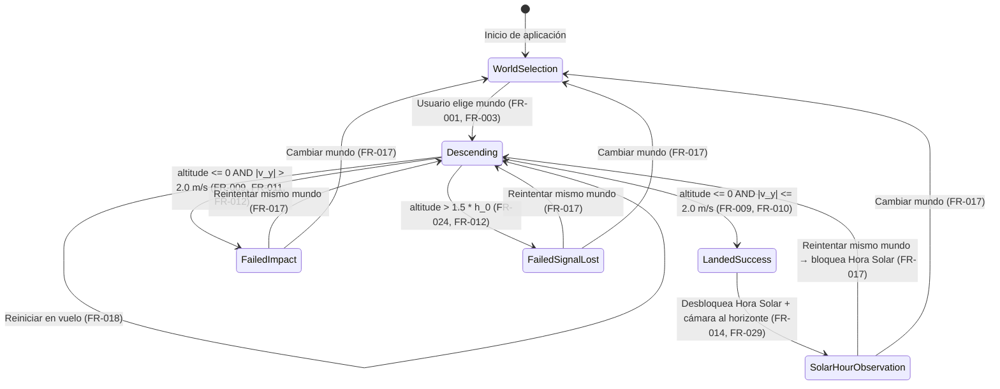

# Phase 1: Data Model — WeinSolar v1

**Feature**: `001-planetary-lander-sunset`  
**Date**: 2026-10-18

El modelo de dominio es **100% agnóstico del framework** y se implementa con los mismos nombres conceptuales (en inglés, según regla de código de ambos stacks) en la capa `domain/models/` tanto en Angular (TypeScript) como en Flutter (Dart puro).

---

## 1. Entidades y Value Objects de Dominio

### 1.1 `CelestialBody` (Mundo)
Representa uno de los 4 cuerpos celestes jugables con sus constantes astrofísicas y ópticas documentadas.

| Campo | Tipo (TS / Dart) | Restricción / Invariante | Descripción |
| :--- | :--- | :--- | :--- |
| `id` | `'earth' \| 'mars' \| 'moon' \| 'titan'` / `CelestialBodyId` | Único, uno de los 4 valores permitidos (**FR-001**) | Identificador canónico del mundo |
| `nameEs` | `string` / `String` | No vacío (`"Tierra"`, `"Marte"`, `"Luna"`, `"Titán"`) | Nombre visible en la UI en español (**FR-002**) |
| `gravity` | `number` / `double` | $> 0$, margen $< 1\%$ respecto a tabla (**FR-004**, **SC-005**) | Gravedad superficial $g$ en $\text{m/s}^2$ |
| `atmosphericDensity` | `number` / `double` | $\ge 0$ (`0` en la Luna, **FR-005**) | Densidad atmosférica superficial $\rho$ en $\text{kg/m}^3$ |
| `timeScale` | `number` / `double` | $\ge 1$ (`2`, `3`, `4`) | Factor de reproducción temporal (**FR-025**, **FR-026**) |
| `initialAltitude` | `number` / `double` | $> 0$ (`500` m) | Altitud inicial del descenso $h_0$ (**FR-003**) |
| `ceilingAltitude` | `number` / `double` | Exactamente $1.5 \times \text{initialAltitude}$ (`750` m, **FR-024**) | Techo de altitud antes de pérdida de señal |
| `initialVelocity` | `number` / `double` | $< 0$ (caída hacia la superficie) | Velocidad vertical inicial $v_0$ en $\text{m/s}$ (**FR-003**) |
| `initialFuel` | `number` / `double` | `100.0` | Porcentaje inicial de combustible ($0\text{–}100\%$) |
| `terrainTheme` | `TerrainTheme` | Libre de colores Weincode (**FR-021**, **FR-028**) | Configuración visual del terreno 3D (colores de suelo, rocas/cráteres/hielo) |
| `skyOpticalProfile` | `SkyOpticalProfile` | Respaldado por `scientificReference` (**FR-015**, **FR-016**) | Curva óptica del cielo y luz según la elevación solar |

---

### 1.2 `LanderState` (Estado de la Sonda)
Representa el estado cinemático e instrumental instantáneo de la sonda durante un intento.

| Campo | Tipo (TS / Dart) | Restricción / Invariante | Descripción |
| :--- | :--- | :--- | :--- |
| `altitude` | `number` / `double` | $\in [0, \text{ceilingAltitude}]$ | Altitud actual sobre la superficie en $\text{m}$ |
| `verticalVelocity` | `number` / `double` | Unidades físicas reales ($\text{m/s}$); negativo = bajando | Velocidad vertical actual $v_y$ |
| `horizontalVelocity` | `number` / `double` | **Siempre `0.0`** en v1 (**FR-008**) | Velocidad horizontal $v_x = 0$ |
| `fuelPercentage` | `number` / `double` | $\in [0.0, 100.0]$ | Combustible restante en porcentaje |
| `isThrusterActive` | `boolean` / `bool` | Efectivo solo si `fuelPercentage > 0` (**FR-006**, **FR-007**) | Estado del propulsor principal |
| `status` | `LanderStatus` | Enum: `descending`, `landed`, `crashed`, `lostSignal` | Estado operativo de la sonda |
| `safeLandingThreshold` | `number` / `double` | **Constante `2.0`** ($\text{m/s}$, inclusivo, **FR-010**) | Umbral estructural máximo de contacto suave |
| `isVelocitySafe` | `boolean` / `bool` (calculado) | `Math.abs(verticalVelocity) <= 2.0` (**FR-020**) | Indicador de velocidad segura para telemetría |
| `isNearCeiling` | `boolean` / `bool` (calculado) | `altitude >= 0.85 * ceilingAltitude` (**FR-019**) | Alerta de proximidad al techo de pérdida de señal |

---

### 1.3 `MissionAttempt` (Intento / Resultado de Misión)
Registra el ciclo de vida y desenlace de un intento de descenso en un mundo determinado.

| Campo | Tipo (TS / Dart) | Restricción / Invariante | Descripción |
| :--- | :--- | :--- | :--- |
| `worldId` | `CelestialBodyId` | Referencia válida a `CelestialBody.id` | Mundo donde se ejecuta la misión |
| `outcome` | `MissionOutcome` | `inProgress \| success \| failedImpact \| failedSignalLost \| abandoned` | Estado/resultado del intento |
| `touchdownVelocity` | `number \| null` / `double?` | Definido al tocar `altitude == 0` | Velocidad vertical en el instante de contacto ($\text{m/s}$) |
| `remainingFuel` | `number` / `double` | $\in [0.0, 100.0]$ | Combustible restante al finalizar (**FR-013**) |
| `isSolarHourUnlocked` | `boolean` / `bool` | **`true` ÚNICAMENTE si `outcome === 'success'`** (**FR-012**, **FR-014**, **Principio II**) | Compuerta de acceso al modo Hora Solar |
| `failureReasonEs` | `string \| null` / `String?` | Presente si `outcome` es `failedImpact` o `failedSignalLost` (**FR-011**) | Motivo del fallo en español para mostrar en el HUD |

---

### 1.4 `SolarHourState` (Estado de Hora Solar y Escena Crepuscular)
Controla la posición del sol, el giro de cámara horizontal y el estado óptico resultante tras un aterrizaje exitoso.

| Campo | Tipo (TS / Dart) | Restricción / Invariante | Descripción |
| :--- | :--- | :--- | :--- |
| `isUnlocked` | `boolean` / `bool` | Debe coincidir con `MissionAttempt.isSolarHourUnlocked` | Bloqueado si no hay aterrizaje exitoso activo |
| `solarElevationDeg` | `number` / `double` | $\in [-10.0, 90.0]$, inicial `65.0` (sol alto, **US2-AS1**) | Ángulo del sol sobre el horizonte en grados |
| `cameraAzimuthDeg` | `number` / `double` | $\in [0.0, 360.0)$ (**FR-029**) | Ángulo de rotación horizontal de la cámara alrededor de la sonda |
| `zenithColorHex` | `string` / `String` | Prohibido usar `#18084D`, `#5236FF`, `#A599FF` (**FR-021**) | Color calculado de la parte alta del cielo |
| `horizonColorHex` | `string` / `String` | Prohibido usar `#18084D`, `#5236FF`, `#A599FF` (**FR-021**) | Color calculado del horizonte |
| `sunHaloColorHex` | `string` / `String` | Azul frío en Marte al atardecer; cálido en Tierra; ámbar difuso en Titán; sin halo en Luna | Color del halo circunsolar |
| `shadowHardness` | `number` / `double` | `1.0` en Luna (duras); `0.15` en Titán (difusas); intermedio en Tierra/Marte (**FR-030**) | Nitidez de sombras en la escena 3D |
| `ambientLightIntensity` | `number` / `double` | `0.0` en Luna; proporcional a dispersión en mundos con atmósfera (**FR-030**) | Luz ambiental del cielo sobre el terreno y la sonda |

---

## 2. Máquina de Estados del Dominio

---

## 3. Reglas de Validación e Invariantes del Dominio (`RN`)

- **RN-01 (Fidelidad Gravimétrica y Atmosférica)**: `gravity` y `atmosphericDensity` deben coincidir con la tabla constitucional (`Tierra: 9.81 / 1.225`, `Marte: 3.71 / 0.020`, `Luna: 1.62 / 0.0`, `Titán: 1.352 / 5.3`) dentro de una tolerancia $\le 1\%$ (**SC-005**).
- **RN-02 (Resistencia Nula en Vacío)**: Si `atmosphericDensity == 0` (Luna), la desaceleración por arrastre aerodinámico debe ser exactamente `0.0` para cualquier velocidad (**FR-005**).
- **RN-03 (Corte por Combustible Agotado)**: Si `fuelPercentage <= 0`, `isThrusterActive` no genera aceleración de empuje ($a_{\text{thrust}} = 0$) y `fuelPercentage` nunca cae por debajo de `0.0` (**FR-007**).
- **RN-04 (Umbral Estructural Inclusivo)**: Al tocar superficie (`altitude <= 0`), si $|v_y| \le 2.0\text{ m/s}$ el resultado es `success`; si $|v_y| > 2.0\text{ m/s}$ (p. ej. `2.1 m/s`) el resultado es `failedImpact` (**FR-009**, **FR-010**, **US1-AS7**).
- **RN-05 (Techo de Pérdida de Señal)**: Si en cualquier tick `altitude > 1.5 * initialAltitude`, el intento termina inmediatamente con `failedSignalLost` ("Misión fallida – señal perdida") (**FR-024**).
- **RN-06 (Bloqueo Estricto de Hora Solar)**: `isSolarHourUnlocked` es `true` sí y solo si `outcome == 'success'`. Cualquier intento de actualizar `solarElevationDeg` cuando `outcome != 'success'` (o tras pulsar "Reintentar") debe ser rechazado o ignorado por el caso de uso (**Principio II**, **FR-012**).
- **RN-07 (Invariancia Física ante Escala Temporal)**: El paso de integración con `timeScale` reproduce la misma curva velocidad-altitud que en tiempo real, y las métricas expuestas al HUD se expresan en unidades físicas reales ($\text{m}$, $\text{m/s}$, $\%$), nunca multiplicadas por `timeScale` (**FR-025**, **FR-026**).
- **RN-08 (Aislamiento Cromático Weincode)**: Los colores del HUD son exclusivamente `#18084D`, `#5236FF`, `#A599FF` y `#FFFFFF`. Ningún color devuelto por `SkyOpticalProfile` o `TerrainTheme` puede coincidir con `#18084D`, `#5236FF` o `#A599FF` (**Principio III**, **FR-021**).
