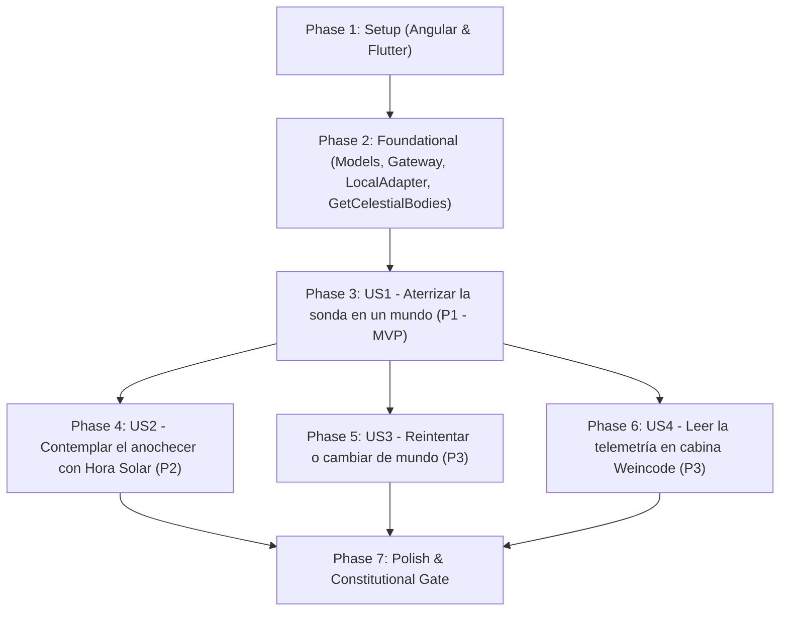

---

description: "Task list for Descenso Planetario y Hora Solar (WeinSolar v1 — Dual Stack: Angular & Flutter)"
---

# Tasks: Descenso Planetario y Hora Solar (WeinSolar v1 — Dual Stack: Angular & Flutter)

**Input**: Design documents from `/specs/001-planetary-lander-sunset/`
**Prerequisites**: [plan.md](plan.md) (required), [spec.md](spec.md) (required for user stories), [research.md](research.md), [data-model.md](data-model.md), [contracts/domain-and-ui-contracts.md](contracts/domain-and-ui-contracts.md), [quickstart.md](quickstart.md)

**Tests**: Tests are included following the **Tests First (TDD)** mandate defined in `plan.md`, `.github/instructions/angular-instructions.md`, and `.github/instructions/flutter-instructions.md`. Domain unit tests (`RN-01`..`RN-08` and Acceptance Criteria) MUST be written and fail before implementing use cases and UI components.

**Organization**: Tasks are grouped by user story (`US1` to `US4`) across both client implementations (`apps/weinsolar-angular` and `apps/weinsolar-flutter`) so each user story can be implemented, verified, and demonstrated as an independent increment.

## Format: `[ID] [P?] [Story] Description`

- **[P]**: Can run in parallel (different files, no dependencies on incomplete tasks)
- **[Story]**: Which user story this task belongs to (`[US1]`, `[US2]`, `[US3]`, `[US4]`)
- Every task includes the exact target file path

## Path Conventions (Dual-Stack Monorepo)

- **🅰️ Angular Web App**: `apps/weinsolar-angular/src/app/{config,domain,infraestructure,UI}/` (strictly preserving `infraestructure` and `UI` directory casing per `.github/instructions/angular-instructions.md`)
- **💙 Flutter Multiplatform App**: `apps/weinsolar-flutter/lib/{config,domain,infrastructure,ui}/` and `apps/weinsolar-flutter/test/{domain,infrastructure,ui}/` (per `.github/instructions/flutter-instructions.md`)

---

## Phase 1: Setup (Shared Infrastructure & Dual-Stack Initialization)

**Purpose**: Initialize both client applications (`apps/weinsolar-angular` and `apps/weinsolar-flutter`), establish local agent contexts (`AGENTS.md`), create Clean Architecture folder hierarchies, and configure strict Weincode HUD color tokens (`#18084D`, `#5236FF`, `#A599FF`, `#FFFFFF`).

- [ ] T001 Initialize Angular 18/19+ standalone project with strict TypeScript configuration in `apps/weinsolar-angular/package.json` and `apps/weinsolar-angular/tsconfig.json`
- [ ] T002 [P] Initialize Flutter 3.x Material 3 project with strict Dart null-safety and lint rules in `apps/weinsolar-flutter/pubspec.yaml` and `apps/weinsolar-flutter/analysis_options.yaml`
- [ ] T003 [P] Create local technical context file for Angular in `apps/weinsolar-angular/AGENTS.md`
- [ ] T004 [P] Create local technical context file for Flutter in `apps/weinsolar-flutter/AGENTS.md`
- [ ] T005 [P] Configure Weincode HUD CSS variables (`#18084D`, `#5236FF`, `#A599FF`, `#FFFFFF`) and base reset styles in `apps/weinsolar-angular/src/styles.scss`
- [ ] T006 [P] Configure Weincode Material 3 `ThemeData` and route definitions in `apps/weinsolar-flutter/lib/config/routes/app_routes.dart` and `apps/weinsolar-flutter/lib/main.dart`

---

## Phase 2: Foundational (Blocking Prerequisites — Domain Models & World Catalog)

**Purpose**: Core domain entities (`CelestialBody`, `LanderState`, `MissionAttempt`, `SolarHourState`), gateway contracts (`CelestialBodyGateway`), local offline adapters (`CelestialBodyLocalAdapter`), and the catalog use case (`GetCelestialBodiesUseCase`) that MUST be complete before any user story can be implemented.

**⚠️ CRITICAL**: No user story work can begin until this phase is complete.

### Foundational Domain Models & Contracts (Angular & Flutter)

- [ ] T007 [P] Create `CelestialBody`, `SkyOpticalProfile`, and `TerrainTheme` domain interfaces in `apps/weinsolar-angular/src/app/domain/models/celestial-body/celestial-body.ts`
- [ ] T008 [P] Create `LanderState` and `LanderStatus` domain models in `apps/weinsolar-angular/src/app/domain/models/simulation/lander-state.ts`
- [ ] T009 [P] Create `MissionAttempt` and `MissionOutcome` domain models in `apps/weinsolar-angular/src/app/domain/models/simulation/mission-attempt.ts`
- [ ] T010 [P] Create `SolarHourState` domain interface in `apps/weinsolar-angular/src/app/domain/models/simulation/solar-hour-state.ts`
- [ ] T011 [P] Create abstract `CelestialBodyGateway` contract in `apps/weinsolar-angular/src/app/domain/models/celestial-body/gateway/celestial-body-gateway.ts`
- [ ] T012 [P] Create pure Dart `CelestialBody`, `SkyOpticalProfile`, and `TerrainTheme` entities in `apps/weinsolar-flutter/lib/domain/models/celestial_body/celestial_body.dart`
- [ ] T013 [P] Create pure Dart `LanderState` and `LanderStatus` entities in `apps/weinsolar-flutter/lib/domain/models/simulation/lander_state.dart`
- [ ] T014 [P] Create pure Dart `MissionAttempt` and `MissionOutcome` entities in `apps/weinsolar-flutter/lib/domain/models/simulation/mission_attempt.dart`
- [ ] T015 [P] Create pure Dart `SolarHourState` entity in `apps/weinsolar-flutter/lib/domain/models/simulation/solar_hour_state.dart`
- [ ] T016 [P] Create abstract `CelestialBodyGateway` contract in `apps/weinsolar-flutter/lib/domain/models/celestial_body/gateway/celestial_body_gateway.dart`

### Foundational Tests First (Catalog & Astrophysical Fidelity RN-01 / SC-005) ⚠️

- [ ] T017 [P] Write unit tests for `GetCelestialBodiesUseCase` (`RN-01`, `FR-001`, `FR-002`, `FR-016`, `FR-024`, `SC-005`) in `apps/weinsolar-angular/src/app/domain/usecase/get-celestial-bodies.use-case.spec.ts`
- [ ] T018 [P] Write unit tests for `CelestialBodyMapper` and `CelestialBodyLocalAdapter` in `apps/weinsolar-angular/src/app/infraestructure/helpers/mappers/celestial-body.mapper.spec.ts` and `apps/weinsolar-angular/src/app/infraestructure/driven-adapter/celestial-body-local/celestial-body-local.adapter.spec.ts`
- [ ] T019 [P] Write pure Dart unit tests for `GetCelestialBodiesUseCase` (`RN-01`, `FR-001`, `FR-002`, `FR-016`, `FR-024`, `SC-005`) in `apps/weinsolar-flutter/test/domain/get_celestial_bodies_use_case_test.dart`
- [ ] T020 [P] Write unit tests for `CelestialBodyLocalAdapter` and mapper in `apps/weinsolar-flutter/test/infrastructure/celestial_body_local_adapter_test.dart`

### Foundational Implementation (Catalog UseCase, Local Adapters & DI Wiring)

- [ ] T021 Implement `GetCelestialBodiesUseCase` validating 4 worlds and astrophysical invariants in `apps/weinsolar-angular/src/app/domain/usecase/get-celestial-bodies.use-case.ts`
- [ ] T022 [P] Implement `CelestialBodyMapper.fromRaw(raw: unknown)` in `apps/weinsolar-angular/src/app/infraestructure/helpers/mappers/celestial-body.mapper.ts`
- [ ] T023 Implement offline `CelestialBodyLocalAdapter` with real constants and NASA/ESA scientific references for Earth, Mars, Moon, and Titan in `apps/weinsolar-angular/src/app/infraestructure/driven-adapter/celestial-body-local/celestial-body-local.adapter.ts`
- [ ] T024 Bind `{ provide: CelestialBodyGateway, useClass: CelestialBodyLocalAdapter }` and lazy route configuration in `apps/weinsolar-angular/src/app/config/app.config.ts` and `apps/weinsolar-angular/src/app/config/app.routes.ts`
- [ ] T025 [P] Implement pure Dart `GetCelestialBodiesUseCase` in `apps/weinsolar-flutter/lib/domain/usecase/get_celestial_bodies_use_case.dart`
- [ ] T026 [P] Implement pure function `celestialBodyDataToEntity` in `apps/weinsolar-flutter/lib/infrastructure/helpers/mappers/celestial_body_mapper.dart`
- [ ] T027 Implement offline `CelestialBodyLocalAdapter` with real constants and NASA/ESA scientific references in `apps/weinsolar-flutter/lib/infrastructure/driven_adapters/celestial_body_local_adapter.dart`

**Checkpoint**: Foundation ready — all 4 worlds and astrophysical constants (`RN-01`, `SC-005`) are tested and available offline in both stacks.

---

## Phase 3: User Story 1 - Aterrizar la sonda en un mundo (Priority: P1) 🎯 MVP

**Goal**: Allow the user to select one of the 4 celestial bodies (Earth, Mars, Moon, Titan), experience a 3D vertical descent under real gravity and atmospheric drag with a third-person camera following the lander, fire the main thruster using keyboard or touch/click to decelerate while consuming fuel, and evaluate touchdown against the structural threshold (`≤ 2,0 m/s` success vs `> 2,0 m/s` crash) and altitude ceiling (`1,5 × h_0` signal lost).

**Independent Test**: Select any world, perform one controlled descent landing at `≤ 2,0 m/s` and one unbraked descent (`> 2,0 m/s`); verify that the first declares "Aterrizaje exitoso" and the second declares "Misión fallida" with destroyed lander state, and that free-fall velocities differ between Moon and Earth/Titan.

### Tests for User Story 1 (Tests First — Mandatory TDD) ⚠️

> **NOTE: Write these tests FIRST and verify they FAIL before implementing `SimulateDescentStepUseCase` or UI components**

- [ ] T028 [P] [US1] Write unit tests for `SimulateDescentStepUseCase` covering gravity, quadratic drag (0 on Moon `RN-02`), thruster burn & fuel depletion (`RN-03`), exact `2.0 m/s` vs `2.1 m/s` boundary (`RN-04`), `1.5 × h_0` ceiling (`RN-05`), `timeScale` invariance (`RN-07`), and `≥ 15%` fuel reserve (`SC-002`) in `apps/weinsolar-angular/src/app/domain/usecase/simulate-descent-step.use-case.spec.ts`
- [ ] T029 [P] [US1] Write pure Dart unit tests for `SimulateDescentStepUseCase` covering `RN-01`..`RN-05`, `RN-07`, `SC-002`, and `CA-US1-1..8` in `apps/weinsolar-flutter/test/domain/simulate_descent_step_use_case_test.dart`

### Implementation for User Story 1 — Angular (`apps/weinsolar-angular`)

- [ ] T030 [US1] Implement `SimulateDescentStepUseCase` with 1D semi-implicit Euler integration ($\Delta t \le 0.05\text{ s}$) in `apps/weinsolar-angular/src/app/domain/usecase/simulate-descent-step.use-case.ts`
- [ ] T031 [P] [US1] Create `WorldCardComponent` displaying Spanish world name and surface gravity (`FR-001`, `FR-002`) in `apps/weinsolar-angular/src/app/UI/ds/molecules/world-card/world-card.component.ts`
- [ ] T032 [P] [US1] Create `ThrusterButtonComponent` supporting pointer press-and-hold and empty fuel disabled state (`FR-006`, `FR-007`, `FR-022`) in `apps/weinsolar-angular/src/app/UI/ds/atoms/thruster-button/thruster-button.component.ts`
- [ ] T033 [US1] Implement 3D descent rendering (third-person camera following lander altitude, world-specific 3D terrain around flat landing pad, and lander intact/crashed visual states per `FR-027`, `FR-028`) in `apps/weinsolar-angular/src/app/UI/ds/organisms/planetary-scene-3d/planetary-scene-3d.component.ts`
- [ ] T034 [US1] Implement `SimulatorComponent` orchestrating world selection, 60 FPS `requestAnimationFrame` loop, keyboard (`Space`/`ArrowUp`) thruster input, and automatic pause on `visibilitychange`/`blur` in `apps/weinsolar-angular/src/app/UI/pages/simulator/simulator.component.ts` and `apps/weinsolar-angular/src/app/UI/main/main.component.ts`

### Implementation for User Story 1 — Flutter (`apps/weinsolar-flutter`)

- [ ] T035 [US1] Implement pure Dart `SimulateDescentStepUseCase` with 1D semi-implicit Euler integration in `apps/weinsolar-flutter/lib/domain/usecase/simulate_descent_step_use_case.dart`
- [ ] T036 [US1] Implement `SimulationProvider` (`ChangeNotifier`) managing selected world, lander state, mission attempt, and simulation tick orchestration in `apps/weinsolar-flutter/lib/config/providers/simulation_provider.dart`
- [ ] T037 [P] [US1] Create `WorldSelectorSheet` displaying the 4 selectable worlds with Spanish names and surface gravity (`FR-001`, `FR-002`) in `apps/weinsolar-flutter/lib/ui/widgets/world_selector_sheet.dart`
- [ ] T038 [P] [US1] Create `ThrusterControlButton` supporting touch/mouse press-and-hold (`GestureDetector`) and empty fuel indicator (`FR-006`, `FR-007`, `FR-022`) in `apps/weinsolar-flutter/lib/ui/widgets/thruster_control_button.dart`
- [ ] T039 [US1] Implement `PlanetaryScene3dPainter` (`CustomPainter` with `Matrix4` 3D projection for third-person descent camera, world-specific 3D terrain around flat landing pad, and lander mesh per `FR-027`, `FR-028`) in `apps/weinsolar-flutter/lib/ui/widgets/planetary_scene_3d_painter.dart`
- [ ] T040 [US1] Implement `SimulatorPage` (`SingleTickerProviderStateMixin` + `WidgetsBindingObserver`) driving the 60 FPS `Ticker`, keyboard (`LogicalKeyboardKey.space`/`arrowUp`) thruster control, and lifecycle pause in `apps/weinsolar-flutter/lib/ui/pages/simulator_page.dart`

**Checkpoint**: User Story 1 (MVP) is complete and independently testable in both Angular and Flutter.

---

## Phase 4: User Story 2 - Contemplar el anochecer con "Hora Solar" (Priority: P2)

**Goal**: Unlock the continuous "Hora Solar" control exclusively after a successful landing (`|v_y| ≤ 2,0 m/s`), transition the 3D camera toward the horizon with 360° horizontal rotation around the lander, and dynamically update sky colors, circumsolar halo, directional lighting, and shadow hardness according to each world's real optical profile (Rayleigh orange/red on Earth, cold blue halo on Mars, permanent black sky with abrupt light cutoff on Moon, diffuse amber haze on Titan).

**Independent Test**: Achieve a successful landing on each of the 4 worlds, move the "Hora Solar" slider from `65°` down to `-10°` and rotate the camera horizontally (`0°..360°`), verifying each world's documented sky transition and confirming that a failed mission completely blocks access to "Hora Solar".

### Tests for User Story 2 (Tests First — Mandatory TDD) ⚠️

- [ ] T041 [P] [US2] Write unit tests for `EvaluateSolarHourUseCase` verifying strict lock on failed/in-progress attempts (`RN-06`, `FR-012`, `SC-004`), optical sky curves for Earth, Mars, Moon, and Titan (`FR-015`, `FR-030`), and zero Weincode color contamination (`RN-08`, `FR-021`) in `apps/weinsolar-angular/src/app/domain/usecase/evaluate-solar-hour.use-case.spec.ts`
- [ ] T042 [P] [US2] Write pure Dart unit tests for `EvaluateSolarHourUseCase` verifying `RN-06`, `RN-08`, `FR-015`, `FR-030`, and `CA-US2-1..6` in `apps/weinsolar-flutter/test/domain/evaluate_solar_hour_use_case_test.dart`

### Implementation for User Story 2 — Angular (`apps/weinsolar-angular`)

- [ ] T043 [US2] Implement `EvaluateSolarHourUseCase` computing `SolarHourState` (`zenithColorHex`, `horizonColorHex`, `sunHaloColorHex`, `shadowHardness`, `ambientLightIntensity`) and enforcing `RN-06` in `apps/weinsolar-angular/src/app/domain/usecase/evaluate-solar-hour.use-case.ts`
- [ ] T044 [P] [US2] Create `SolarHourSliderComponent` for continuous solar elevation (`[-10°, 90°]`) and horizontal camera azimuth rotation (`[0°, 360°)`) in `apps/weinsolar-angular/src/app/UI/ds/molecules/solar-hour-slider/solar-hour-slider.component.ts`
- [ ] T045 [US2] Extend `PlanetaryScene3dComponent` with post-landing horizon camera transition, 360° horizontal orbit (`FR-029`), real-time sky gradient/halo interpolation (`FR-015`), and dynamic sun direction shadows (`FR-030`) in `apps/weinsolar-angular/src/app/UI/ds/organisms/planetary-scene-3d/planetary-scene-3d.component.ts`
- [ ] T046 [US2] Connect `EvaluateSolarHourUseCase` and `SolarHourSliderComponent` to `SimulatorComponent` (visible only when `isSolarHourUnlocked() === true`) in `apps/weinsolar-angular/src/app/UI/pages/simulator/simulator.component.ts`

### Implementation for User Story 2 — Flutter (`apps/weinsolar-flutter`)

- [ ] T047 [US2] Implement pure Dart `EvaluateSolarHourUseCase` enforcing `RN-06` and calculating optical sky and lighting parameters in `apps/weinsolar-flutter/lib/domain/usecase/evaluate_solar_hour_use_case.dart`
- [ ] T048 [P] [US2] Create `SolarHourControlPanel` widget with continuous solar elevation slider (`[-10°, 90°]`) and horizontal camera rotation control (`[0°, 360°)`) in `apps/weinsolar-flutter/lib/ui/widgets/solar_hour_control_panel.dart`
- [ ] T049 [US2] Extend `PlanetaryScene3dPainter` with horizon camera view, horizontal azimuth rotation (`FR-029`), optical sky/halo rendering (`FR-015`), and dynamic terrain/lander shadow projection (`FR-030`) in `apps/weinsolar-flutter/lib/ui/widgets/planetary_scene_3d_painter.dart`
- [ ] T050 [US2] Integrate `EvaluateSolarHourUseCase` and `SolarHourControlPanel` into `SimulationProvider` and `SimulatorPage` in `apps/weinsolar-flutter/lib/config/providers/simulation_provider.dart` and `apps/weinsolar-flutter/lib/ui/pages/simulator_page.dart`

**Checkpoint**: User Stories 1 AND 2 work independently and together; "Hora Solar" is strictly gated behind successful landings (`SC-004`).

---

## Phase 5: User Story 3 - Reintentar o cambiar de mundo (Priority: P3)

**Goal**: Enable the user to retry the current world from initial conditions (`Reintentar`), return to the 4-world selection screen (`Cambiar mundo`) after any mission outcome (showing touchdown velocity, remaining fuel on success, or failure reason on crash/signal loss), or abort and restart an in-flight descent (`Reiniciar`), immediately relocking "Hora Solar" upon retry.

**Independent Test**: Trigger a crash or signal loss, press "Reintentar" and verify initial altitude, velocity, and 100% fuel are restored in `< 2 s` (`SC-008`) with "Hora Solar" locked; press "Cambiar mundo" and verify navigation back to world selection; press "Reiniciar" mid-descent and verify immediate reset.

### Tests for User Story 3 (Tests First) ⚠️

- [ ] T051 [P] [US3] Write component integration tests for in-flight reset (`FR-018`), post-mission retry relocking Solar Hour (`FR-017`), and world switching in `apps/weinsolar-angular/src/app/UI/pages/simulator/simulator.component.spec.ts`
- [ ] T052 [P] [US3] Write widget tests for retry, in-flight reset, and change-world flows in `apps/weinsolar-flutter/test/ui/simulator_page_widget_test.dart`

### Implementation for User Story 3 — Angular (`apps/weinsolar-angular`)

- [ ] T053 [P] [US3] Create `MissionResultBannerComponent` displaying outcome summary (touchdown velocity, remaining fuel or failure reason, and scientific reference) with "Reintentar" and "Cambiar mundo" actions (`FR-011`, `FR-013`, `FR-016`, `FR-017`) in `apps/weinsolar-angular/src/app/UI/ds/molecules/mission-result-banner/mission-result-banner.component.ts`
- [ ] T054 [US3] Implement `retryMission()`, `resetInFlight()`, and `changeWorld()` state transitions (relocking `SolarHourState`) in `apps/weinsolar-angular/src/app/UI/pages/simulator/simulator.component.ts`

### Implementation for User Story 3 — Flutter (`apps/weinsolar-flutter`)

- [ ] T055 [P] [US3] Create `MissionOutcomeOverlay` widget showing touchdown velocity, remaining fuel or failure reason, scientific reference, and "Reintentar" / "Cambiar mundo" buttons (`FR-011`, `FR-013`, `FR-016`, `FR-017`) in `apps/weinsolar-flutter/lib/ui/widgets/mission_outcome_overlay.dart`
- [ ] T056 [US3] Implement `retryCurrentWorld()`, `resetInFlight()`, and `returnToWorldSelection()` methods in `apps/weinsolar-flutter/lib/config/providers/simulation_provider.dart` and wire them in `apps/weinsolar-flutter/lib/ui/pages/simulator_page.dart`

**Checkpoint**: Full gameplay loop (Select → Descend → Land/Crash → Solar Hour → Retry/Change World) is complete in both stacks.

---

## Phase 6: User Story 4 - Leer la telemetría en la cabina Weincode (Priority: P3)

**Goal**: Present real-time flight telemetry inside the Weincode cockpit HUD (`#18084D`, `#5236FF`, `#A599FF`, `#FFFFFF`) displaying altitude, vertical velocity with safe/dangerous visual status (`≤ 2,0 m/s` vs `> 2,0 m/s`), fuel percentage (and `"Sin combustible"` warning at `0%`), world name, surface gravity, safe landing threshold, altitude ceiling (`1,5 × h_0`) with proximity alert (`≥ 85%`), and active time scale factor (`×2`, `×3`, `×4`), without tinting the 3D canvas.

**Independent Test**: Start a descent and inspect the cockpit HUD to verify all telemetry badges update in real time (`< 0.1 s`, `SC-007`), the velocity indicator switches between `"VELOCIDAD SEGURA (≤ 2,0 m/s)"` and `"PELIGRO (> 2,0 m/s)"`, and only the 4 official Weincode hex codes are used in the HUD while the 3D scene remains uncontaminated.

### Tests for User Story 4 (Tests First) ⚠️

- [ ] T057 [P] [US4] Write unit tests for `WeincodeCockpitHudComponent` verifying all required telemetry fields (`FR-019`, `FR-020`, `FR-026`) and strict Weincode palette compliance (`#18084D`, `#5236FF`, `#A599FF`, `#FFFFFF`, `FR-021`) in `apps/weinsolar-angular/src/app/UI/ds/organisms/weincode-cockpit-hud/weincode-cockpit-hud.component.spec.ts`
- [ ] T058 [P] [US4] Add HUD telemetry and Weincode palette verification tests (`FR-019`, `FR-020`, `FR-021`, `FR-026`) to `apps/weinsolar-flutter/test/ui/simulator_page_widget_test.dart`

### Implementation for User Story 4 — Angular (`apps/weinsolar-angular`)

- [ ] T059 [P] [US4] Create `TelemetryBadgeComponent` atom for metric display and safe/warning states using strictly `#18084D`, `#5236FF`, `#A599FF`, and `#FFFFFF` in `apps/weinsolar-angular/src/app/UI/ds/atoms/telemetry-badge/telemetry-badge.component.ts`
- [ ] T060 [US4] Implement `WeincodeCockpitHudComponent` organism rendering altitude, velocity status, fuel percentage, world gravity, safe threshold (`2,0 m/s`), ceiling alert, time scale badge (`×N`), and in-flight reset button in `apps/weinsolar-angular/src/app/UI/ds/organisms/weincode-cockpit-hud/weincode-cockpit-hud.component.ts`
- [ ] T061 [US4] Create `SimulatorShellComponent` template overlaying `WeincodeCockpitHudComponent` on top of `PlanetaryScene3dComponent` without bleeding HUD styles into the 3D `<canvas>` in `apps/weinsolar-angular/src/app/UI/ds/organisms/weincode-cockpit-hud/weincode-cockpit-hud.component.ts` and `apps/weinsolar-angular/src/app/UI/ds/templates/simulator-shell/simulator-shell.component.ts`

### Implementation for User Story 4 — Flutter (`apps/weinsolar-flutter`)

- [ ] T062 [US4] Implement `WeincodeCockpitHud` widget rendering real-time telemetry, safe/dangerous velocity badge, ceiling proximity alert, fuel bar (`"Sin combustible"` at `0%`), time scale badge (`×N`), and in-flight reset button using exclusively `0xFF18084D`, `0xFF5236FF`, `0xFFA599FF`, and `0xFFFFFFFF` in `apps/weinsolar-flutter/lib/ui/widgets/weincode_cockpit_hud.dart`
- [ ] T063 [US4] Integrate `WeincodeCockpitHud` overlay onto the `Stack` in `apps/weinsolar-flutter/lib/ui/pages/simulator_page.dart`

**Checkpoint**: All 4 User Stories (`US1`–`US4`) are complete, independently tested, and visually compliant with the Weincode Constitution in both Angular and Flutter.

---

## Phase 7: Polish & Cross-Cutting Concerns

**Purpose**: Final cross-stack quality gates, static analysis, production build verification, and constitutional compliance audit.

- [ ] T064 [P] Run Angular unit test suite and production build verification (`npm --prefix apps/weinsolar-angular test -- --watch=false && npm --prefix apps/weinsolar-angular run build`) validating `apps/weinsolar-angular/angular.json`
- [ ] T065 [P] Run Flutter test suite and static analyzer (`flutter test apps/weinsolar-flutter/test && dart analyze apps/weinsolar-flutter`) validating `apps/weinsolar-flutter/pubspec.yaml`
- [ ] T066 Execute end-to-end constitutional and offline verification checklist from `specs/001-planetary-lander-sunset/quickstart.md` across both applications

---

## Dependencies & Execution Order

### Phase Dependencies

- **Phase 1 (Setup)**: No dependencies — can start immediately in parallel for Angular and Flutter.
- **Phase 2 (Foundational)**: Depends on Phase 1 — **BLOCKS all user stories** until domain models, `CelestialBodyGateway`, `CelestialBodyLocalAdapter`, and `GetCelestialBodiesUseCase` tests pass in both stacks.
- **Phase 3 (User Story 1 - P1 🎯 MVP)**: Depends on Phase 2 completion. Delivers playable 3D planetary descent and landing evaluation.
- **Phase 4 (User Story 2 - P2)**: Depends on Phase 2 (and integrates with `MissionAttempt.outcome === 'success'` from US1). Delivers the "Hora Solar" 3D sunset observation reward.
- **Phase 5 (User Story 3 - P3)**: Depends on Phase 3 (and resets state from US1/US2). Delivers retry, in-flight reset, and world switching.
- **Phase 6 (User Story 4 - P3)**: Depends on Phase 3. Delivers the full Weincode cockpit telemetry HUD overlay.
- **Phase 7 (Polish)**: Depends on Phases 3–6 completion.

### User Story Dependency Graph



### Within Each User Story

1. **Tests First (TDD)**: Write unit/component/widget tests first and confirm they fail before writing implementation code.
2. **Domain UseCase**: Implement pure TypeScript / pure Dart business logic until domain tests pass.
3. **UI Components / Widgets & 3D Scene**: Build presentation components consuming use cases/providers.
4. **Page Integration**: Connect controls, 60 FPS loop, and lifecycle listeners in `SimulatorComponent` (Angular) and `SimulatorPage` (Flutter).

---

## Parallel Execution Examples

### Example 1: Phase 2 Foundational Models (Angular & Flutter in Parallel)

```bash
# Angular and Flutter domain models have zero shared files and can be created concurrently:
Task T007: "Create CelestialBody, SkyOpticalProfile, and TerrainTheme domain interfaces in apps/weinsolar-angular/src/app/domain/models/celestial-body/celestial-body.ts"
Task T012: "Create pure Dart CelestialBody, SkyOpticalProfile, and TerrainTheme entities in apps/weinsolar-flutter/lib/domain/models/celestial_body/celestial_body.dart"
Task T017: "Write unit tests for GetCelestialBodiesUseCase in apps/weinsolar-angular/src/app/domain/usecase/get-celestial-bodies.use-case.spec.ts"
Task T019: "Write pure Dart unit tests for GetCelestialBodiesUseCase in apps/weinsolar-flutter/test/domain/get_celestial_bodies_use_case_test.dart"
```

### Example 2: User Story 1 (MVP) Dual-Stack Parallel Execution

```bash
# Write US1 physics unit tests in parallel across stacks:
Task T028: "Write unit tests for SimulateDescentStepUseCase in apps/weinsolar-angular/src/app/domain/usecase/simulate-descent-step.use-case.spec.ts"
Task T029: "Write pure Dart unit tests for SimulateDescentStepUseCase in apps/weinsolar-flutter/test/domain/simulate_descent_step_use_case_test.dart"

# Build UI atoms/molecules in parallel once UseCases pass:
Task T031: "Create WorldCardComponent in apps/weinsolar-angular/src/app/UI/ds/molecules/world-card/world-card.component.ts"
Task T032: "Create ThrusterButtonComponent in apps/weinsolar-angular/src/app/UI/ds/atoms/thruster-button/thruster-button.component.ts"
Task T037: "Create WorldSelectorSheet in apps/weinsolar-flutter/lib/ui/widgets/world_selector_sheet.dart"
Task T038: "Create ThrusterControlButton in apps/weinsolar-flutter/lib/ui/widgets/thruster_control_button.dart"
```

### Example 3: User Story 2 ("Hora Solar") Parallel Execution

```bash
# Write US2 optical evaluation tests in parallel:
Task T041: "Write unit tests for EvaluateSolarHourUseCase in apps/weinsolar-angular/src/app/domain/usecase/evaluate-solar-hour.use-case.spec.ts"
Task T042: "Write pure Dart unit tests for EvaluateSolarHourUseCase in apps/weinsolar-flutter/test/domain/evaluate_solar_hour_use_case_test.dart"
```

---

## Implementation Strategy

### MVP First (User Story 1 Only)

1. Complete **Phase 1: Setup** (`T001`–`T006`).
2. Complete **Phase 2: Foundational** (`T007`–`T027`) — verifies all 4 worlds and real astrophysical constants (`RN-01`).
3. Complete **Phase 3: User Story 1** (`T028`–`T040`) — delivers 3D vertical descent, real gravity/drag physics, thruster control, and `2.0 m/s` landing evaluation.
4. **STOP and VALIDATE**: Run unit tests in both stacks and test landing vs crashing on Earth, Mars, Moon, and Titan.

### Incremental Delivery

1. **Foundation (`T001`–`T027`)** → Catalog and offline architecture ready.
2. **+ US1 (`T028`–`T040`)** → Playable 3D planetary lander MVP in Angular and Flutter.
3. **+ US2 (`T041`–`T050`)** → Unlocks "Hora Solar" 3D sunset reward and horizon camera rotation upon successful landing.
4. **+ US3 (`T051`–`T056`)** → Adds instant retry, in-flight reset, and world switching.
5. **+ US4 (`T057`–`T063`)** → Completes the Weincode cockpit telemetry HUD with strict `#18084D`, `#5236FF`, `#A599FF`, `#FFFFFF` palette isolation.
6. **+ Polish (`T064`–`T066`)** → Full test suite, static analysis, and offline verification.
